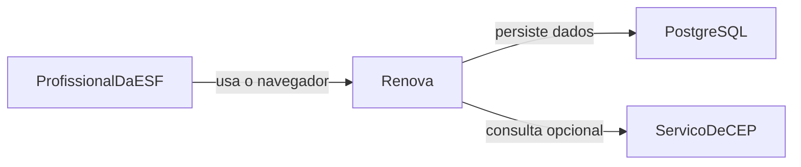

# 01 — Visão geral

O Renova é um sistema de gestão de receitas médicas e de acompanhamento de vencimentos para o contexto de uma Estratégia Saúde da Família (ESF).

A especificação abaixo orienta a implementação. O software ainda não foi construído.

## Contexto

Na rotina da ESF, a equipe precisa saber quais receitas venceram ou estão perto de vencer, organizar o acompanhamento dos pacientes e registrar as providências tomadas. Hoje esse controle depende de cadernos, papéis, planilhas e consultas manuais. A informação se dispersa, o prazo passa sem destaque visual e a busca ativa fica difícil de priorizar.

As etapas de empatia, definição, ideação e prototipação já foram concluídas. Existe um protótipo visual de login, painel operacional e cadastro de receita. Ele está fora deste repositório, no arquivo `care-calm-clarity-main/src/renova/document.html`. Este repositório não contém cópia desse arquivo e não deve recriá-lo.

## Problema

A equipe não dispõe de um registro único que:

- identifique o paciente pelo CPF e o vincule às suas receitas;
- mostre, sem conferência manual de cada linha, se a receita está vencida, próxima do vencimento, dentro do prazo ou sem data válida;
- destaque visualmente o que exige atenção;
- guarde a providência tomada, com data e descrição;
- restrinja o acesso conforme o perfil do profissional.

## Objetivo geral

Centralizar o cadastro de pacientes e receitas médicas, acompanhar datas de vencimento, gerar alertas visuais e apoiar a organização das ações dos profissionais da ESF.

## Objetivo da primeira versão demonstrável

O primeiro fluxo funcional, de ponta a ponta, é:

1. O profissional entra no sistema com login.
2. Localiza um paciente pelo CPF ou cadastra um novo.
3. Consulta e atualiza os dados cadastrais permitidos.
4. Cadastra uma receita vinculada a esse paciente.
5. O sistema armazena a receita e permite consultá-la depois.
6. A situação da receita é identificada automaticamente pela data de vencimento.
7. O dashboard apresenta indicadores e alertas visuais.
8. O profissional identifica pacientes que precisam de acompanhamento prioritário.

O detalhamento do que é obrigatório, simplificado ou futuro está em [10-planejamento-sprints.md](10-planejamento-sprints.md). Registrar uma prioridade de sprint não remove o requisito: todas as histórias US01 a US10 permanecem especificadas em [02-requisitos-funcionais.md](02-requisitos-funcionais.md).

## Público-alvo

Profissionais autorizados da ESF que acompanham receitas e pacientes. Os papéis iniciais, ainda sujeitos à confirmação da equipe ([DEC-10](11-decisoes-e-pendencias.md)), são:

- Administrador, para gestão administrativa e de acessos.
- Médico ou profissional habilitado, para operações autorizadas relacionadas às receitas.
- Recepção, para operações administrativas que forem autorizadas.
- Agente Comunitário de Saúde (ACS), para consulta e atualização dos dados permitidos e para o acompanhamento dos pacientes.

Um papel de acesso ao software não é a habilitação legal para praticar ato clínico. Quem pode registrar, alterar ou cancelar uma receita precisa ser decidido pela equipe e, quando couber, pela regra institucional. A matriz inicial está em [02-requisitos-funcionais.md](02-requisitos-funcionais.md) e em [DEC-10](11-decisoes-e-pendencias.md).

Pacientes não são usuários do sistema nesta especificação.

## O que o protótipo informa

O protótipo é referência visual e de fluxo. Ele não é a especificação fechada.

Preservar na tela de login:

- apresentação em cartão;
- o texto “Centro de Trabalho Clínico”;
- o nome Renova;
- o subtítulo “Acesso ao Prontuário Clínico e Receitas”;
- os campos Usuário e Senha;
- o botão “Entrar no Sistema”.

Os atalhos de teste do protótipo, que entram com um clique e guardam senha em texto puro, não fazem parte do sistema real.

O protótipo também mostra quatro indicadores operacionais: receitas vencidas, vencendo em até 5 dias, vencendo na janela de 6 a 15 dias e em dia acima de 15 dias. Essa divisão é a proposta inicial dos alertas ([DEC-03](11-decisoes-e-pendencias.md)). A ficha do paciente no protótipo inclui nome, nascimento, telefone, CEP, logradouro, número e bairro, e consulta CEP por um serviço externo. O provedor definitivo não está escolhido ([DEC-06](11-decisoes-e-pendencias.md)).

O protótipo ainda exibe medicamentos com validade própria, tipo de receita comum ou controlada, renovação por prazo, microárea, ACS responsável, impressão e fila de WhatsApp. Esses elementos ficam registrados como avaliação futura em [DEC-12](11-decisoes-e-pendencias.md). Eles não viram regra clínica nesta especificação.

## Área interna

A área autenticada usa layout com menu lateral esquerdo. Os itens iniciais são:

- Dashboard
- Receitas
- Pacientes
- Histórico de Acompanhamento
- Alertas e Prioridades
- Usuários, Cargos e Permissões

Essa organização está definida para a implementação ([DEC-11](11-decisoes-e-pendencias.md)). Ela é diferente da tela única do protótipo. O conteúdo visual dos cartões de vencimento pode seguir as cores do protótipo, com texto associado a cada cor ([US08](02-requisitos-funcionais.md)).

## Escopo

Entram na especificação, mesmo quando a implementação for faseada:

- autenticação por usuário e senha, com autorização no servidor;
- cadastro, consulta e atualização cadastral de pacientes, com CPF único;
- histórico de alteração de nome;
- consulta de CEP opcional, com preenchimento manual quando o serviço falhar;
- cadastro e consulta de receitas vinculadas a um paciente;
- cálculo da situação pela data de vencimento e pela data corrente;
- dashboard, alertas visuais e lista de pacientes prioritários;
- histórico de acompanhamento com data e descrição da providência;
- papéis e permissões, com matriz inicial sujeita a validação;
- auditoria de eventos relevantes, sem registrar senha nem token.

## Limites

Esta especificação não:

- implementa prontuário eletrônico completo;
- define conduta clínica, posologia obrigatória nem validade jurídica de receita controlada;
- integra o Renova a sistemas oficiais de saúde, farmácia ou notificação por WhatsApp;
- autoriza o uso de dados reais de pacientes;
- declara conformidade com a LGPD pelo simples fato de recomendar controles;
- substitui caderno ou sistema oficial da unidade até que os responsáveis decidam o contrário.

Medicamento, data de emissão, profissional responsável, validade clínica por item e cancelamento estão modelados apenas no que é necessário para não bloquear a primeira versão. O que falta decidir está em [DEC-07](11-decisoes-e-pendencias.md), [DEC-08](11-decisoes-e-pendencias.md) e [DEC-12](11-decisoes-e-pendencias.md).

## Diagrama de contexto

O serviço de CEP é dependência externa opcional. Ele não está integrado. Se estiver indisponível, o profissional informa o endereço manualmente ([RN06](04-regras-de-negocio.md)).

## Visão da solução

O navegador executa a interface em React. Essa interface chama a API REST do NestJS. O NestJS aplica validação, autenticação, autorização e regras de negócio, e o Prisma acessa o PostgreSQL. A situação da receita é calculada na leitura, a partir da data de vencimento e da data corrente no fuso `America/Sao_Paulo`. Ela não é uma coluna que precise ser atualizada todo dia ([DEC-02](11-decisoes-e-pendencias.md)).

Os documentos seguintes detalham requisitos, regras, arquitetura, dados, API, segurança, testes e a ordem de construção.
