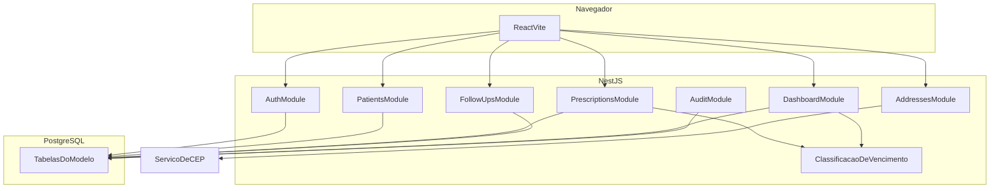
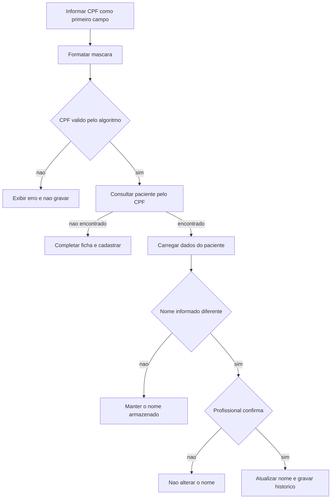
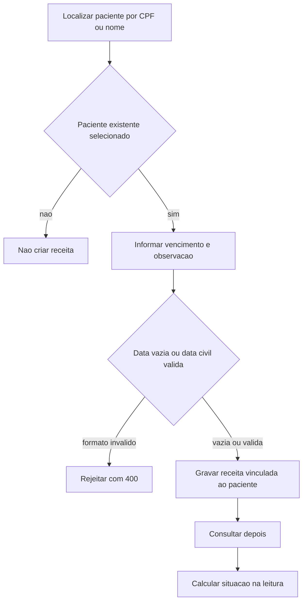

# 05 — Arquitetura

O Renova seguirá arquitetura cliente-servidor. O navegador executa a interface. O servidor aplica regras e persiste os dados. Esta arquitetura está definida para a implementação e ainda não está codificada.

## Stack

| Responsabilidade | Tecnologia | Papel |
| --- | --- | --- |
| Interface | React, TypeScript e Vite | Telas, validação imediata de máscara e consumo da API |
| API | Node.js, NestJS e TypeScript | Autenticação, autorização, regras de negócio e contrato HTTP |
| Persistência | PostgreSQL | Dados relacionais e restrições de unicidade |
| Acesso a dados | Prisma | Mapeamento do modelo lógico e migrations, na fase de implementação |
| Contrato | OpenAPI 3.0.3 | Especificação em [api/openapi.yaml](api/openapi.yaml), com Swagger UI futura no NestJS |
| Versão | Git e GitHub | Histórico do código quando o repositório remoto for criado |

Não há substituição dessas tecnologias. Pontos ainda abertos, como algoritmo de hash e provedor de CEP, estão em [11-decisoes-e-pendencias.md](11-decisoes-e-pendencias.md) e não trocam a stack.

## Responsabilidades

### Front-end

- Apresenta o login no modelo visual do protótipo e a área interna com menu lateral ([DEC-11](11-decisoes-e-pendencias.md)).
- Formata CPF, telefone e CEP enquanto o profissional digita.
- Impede envio evidente de campo obrigatório vazio, sem dispensar a validação do servidor.
- Envia o token de acesso nas chamadas autenticadas.
- Destaca receita vencida com texto e cor.
- Trata lista vazia, `401`, `403`, `404`, `409` e falha de CEP com mensagens da interface.
- Não calcula a situação de vencimento como fonte da verdade. Pode exibir o valor devolvido pela API. Se precisar ordenar na tela, usa os campos já calculados no servidor.

### Back-end

- Valida entrada e dígitos de CPF.
- Autentica e autoriza.
- Calcula idade, situação da receita e faixa de alerta.
- Confirma alteração de nome e grava o histórico na mesma unidade de trabalho.
- Adapta a consulta opcional de CEP.
- Persiste por meio do Prisma.
- Registra auditoria sem segredos.
- Devolve erros sem detalhe interno de infraestrutura.

### Banco

- Garante unicidade de CPF e de nome de usuário.
- Garante a chave estrangeira da receita para o paciente.
- Armazena hash de senha, nunca a senha.
- Não armazena a situação calculada da receita.

## Módulos de domínio previstos

Módulos NestJS da primeira versão:

| Módulo | Responsabilidade |
| --- | --- |
| `AuthModule` | Login, token e identificação do usuário corrente |
| `UsersModule` | Usuário, papel e permissão. Gestão completa fica para evolução |
| `PatientsModule` | Paciente, CPF, nome e histórico de nome |
| `PrescriptionsModule` | Receita e classificação de vencimento |
| `FollowUpsModule` | Acompanhamento |
| `DashboardModule` | Indicadores, alertas e pacientes prioritários |
| `AddressesModule` | Adaptador de CEP, isolado do restante do domínio |
| `AuditModule` | Trilha dos eventos de [RN15](04-regras-de-negocio.md) |

A regra de classificação fica em um serviço de domínio usado por receitas e pelo dashboard, para que dashboard e lista não divergam.

## Diagrama de componentes



O serviço de CEP fica fora do Renova. A seta existe somente quando o adaptador está habilitado ([DEC-06](11-decisoes-e-pendencias.md)).

## Fluxo de uma requisição

1. O React envia HTTPS, no ambiente publicado, para `/api/v1`.
2. O NestJS identifica a rota. `POST /auth/login` segue sem token.
3. Nas demais rotas, o guard verifica o JWT e se o usuário está ativo.
4. O guard de permissão confere o código exigido pela operação.
5. O pipe valida o corpo e os parâmetros.
6. O caso de uso aplica a regra de negócio e abre uma transação quando há mais de uma escrita.
7. O Prisma grava ou lê o PostgreSQL.
8. A classificação de vencimento é aplicada aos objetos de receita antes da resposta.
9. A resposta segue o schema do OpenAPI.

Rotas estáticas `GET /patients/priority` e `GET /prescriptions/alerts` precisam ser registradas de forma a não serem capturadas por `GET /patients/{id}` e `GET /prescriptions/{id}`.

## Fluxo de autenticação e autorização

```mermaid
flowchart TD
  login[Enviar usuario e senha] --> server[Validar no servidor]
  server -->|credencial invalida ou usuario inativo| deny[Responder 401 generico e auditar]
  server -->|usuario ativo| token[Emitir JWT com expiracao]
  token --> call[Chamar endpoint com Bearer]
  call --> guard[Verificar token e usuario ativo]
  guard -->|ausente invalido ou expirado| unauth[Responder 401]
  guard -->|valido| permission[Verificar permissao no servidor]
  permission -->|ausente| forbidden[Responder 403 sem dados do recurso]
  permission -->|presente| useCase[Executar regra de negocio]
```

A recomendação de duração do token é 60 minutos ([DEC-01](11-decisoes-e-pendencias.md)). O logout da primeira versão remove o token no navegador. Não há lista de revogação até o vencimento. Por isso, desativar o usuário também precisa ser verificado no servidor a cada requisição, não apenas na emissão do token.

## Fluxo de cadastro e localização de paciente



## Fluxo de cadastro e consulta de receita



## Fluxo de classificação de vencimento

```mermaid
flowchart TD
  item[Receita consultada] --> life{Ciclo de vida ativo}
  life -->|cancelada| aside[Fora dos indicadores operacionais]
  item --> has{Data de vencimento presente}
  has -->|nao| pending[PENDENTE_INFORMACAO]
  has -->|sim| cmp{Comparar com hoje em America/Sao_Paulo}
  cmp -->|anterior| expired[Situacao VENCIDA]
  cmp -->|igual ou posterior| onTime[Situacao DENTRO_DO_PRAZO]
  expired --> bandV[Faixa VENCIDA]
  onTime --> days{Dias ate o vencimento}
  days -->|zero a cinco| band5[Faixa PROXIMA_5]
  days -->|seis a quinze| band15[Faixa PROXIMA_15]
  days -->|acima de quinze| bandOk[Faixa DENTRO_DO_PRAZO]
```



As faixas depois da situação base são a proposta [DEC-03](11-decisoes-e-pendencias.md). A situação `VENCIDA` ou `DENTRO_DO_PRAZO` já está definida pela [RN09](04-regras-de-negocio.md).

## Decisões arquiteturais já assumidas

- API REST em JSON, prefixo `/api/v1`.
- Autorização no servidor, com códigos de permissão.
- Situação de vencimento calculada, não persistida.
- CEP atrás de adaptador, para o domínio não depender de um provedor.
- Front-end e back-end em repositórios ou pastas separados na implementação (`apps/web` e `apps/api` é uma organização recomendada, não um requisito de negócio).

## O que fica para a implementação

Estrutura de pastas, `package.json`, schema Prisma, migrations, módulos NestJS, telas React e pipeline de CI não são criados nesta etapa. O próximo passo recomendado está em [10-planejamento-sprints.md](10-planejamento-sprints.md).
