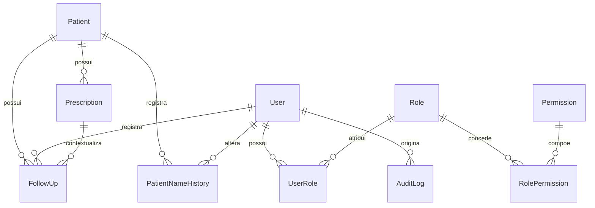

# 06 — Modelagem de dados

Modelo conceitual e lógico inicial para PostgreSQL, acessado por Prisma na implementação. Os tipos abaixo são conceituais. A migration ainda não existe.

Identificadores primários são UUID gerados pela aplicação ou pelo banco. Instantâneos usam data e hora com fuso. Datas de nascimento, vencimento e acompanhamento usam data civil, sem horário.

## Visão dos relacionamentos

Cardinalidades:

- Um paciente possui zero ou várias receitas. Uma receita pertence a um paciente.
- Um paciente possui zero ou vários acompanhamentos. Um acompanhamento pertence a um paciente.
- Um usuário registra zero ou vários acompanhamentos. O acompanhamento guarda o autor.
- Um usuário possui um ou mais papéis por meio de `UserRole`. Na primeira versão, o seed usa um papel por usuário.
- Um papel concede zero ou várias permissões por meio de `RolePermission`.
- Uma receita pode ser citada por zero ou vários acompanhamentos. O vínculo é opcional.
- O histórico de nome pertence a um paciente e registra o usuário autor quando a sessão existir.

`PrescriptionItem` não aparece no diagrama da primeira versão. A avaliação está na seção final deste documento.

## O que entra na primeira versão

| Entidade | Por que entra agora |
| --- | --- |
| `User`, `Role`, `Permission`, `UserRole`, `RolePermission` | US10 e RN13 exigem usuário, papel e permissão verificados no servidor. |
| `Patient` | US01 e US02. |
| `PatientNameHistory` | US01-CA07 e RN04 exigem rastrear a troca de nome. |
| `Prescription` | US04 a US08. A data de vencimento fica nesta entidade. |
| `FollowUp` | US03 e RN14, em registro básico na prioridade P1. |
| `AuditLog` | US10-CA09 e RN15. |

## O que pode esperar

| Entidade ou campo | Motivo para adiar |
| --- | --- |
| `PrescriptionItem` | O protótipo lista medicamentos com validade própria. As histórias US04 a US06 falam da data de vencimento da receita, não de itens. Incluir itens agora fixaria regra clínica não fornecida ([DEC-07](11-decisoes-e-pendencias.md), [DEC-12](11-decisoes-e-pendencias.md)). |
| Microárea e ACS responsável no paciente | Existem no protótipo e ajudam a territorialização da ESF, mas não estão nas histórias. Podem ser colunas opcionais depois da confirmação. |
| Tipo de receita, data de emissão e profissional emissor | Precisam de definição clínica e institucional. Não são obrigatórios para classificar o vencimento informado. |
| Tabela de renovação | A renovação, nesta versão, é texto no acompanhamento e, se a equipe autorizar, uma nova data na própria receita. |

## User

**Finalidade:** profissional que acessa o sistema.

| Campo | Tipo conceitual | Obrigatório | Observação |
| --- | --- | --- | --- |
| `id` | UUID | sim | Chave primária |
| `username` | texto curto | sim | Único, comparação sem diferenciar maiúsculas |
| `passwordHash` | texto | sim | Somente hash. Nunca sai na API |
| `fullName` | texto | sim | Nome de exibição |
| `active` | booleano | sim | Inativo não autentica |
| `createdAt` | instante | sim | |
| `updatedAt` | instante | sim | |

**Unicidade:** `username`.

**Exclusão:** não há exclusão física na primeira versão. Desativação usa `active = false`.

**Dados sensíveis:** credencial. O hash é dado secreto de autenticação.

**Rastreio:** US10, RN13, RN15.

## Role

**Finalidade:** papel de acesso, como Administrador ou ACS.

| Campo | Tipo conceitual | Obrigatório | Observação |
| --- | --- | --- | --- |
| `id` | UUID | sim | Chave primária |
| `code` | texto curto | sim | Único. Proposta: `ADMINISTRADOR`, `MEDICO`, `RECEPCAO`, `ACS` |
| `name` | texto | sim | Rótulo de interface |
| `description` | texto | não | |

**Exclusão:** papéis de seed não são apagados enquanto houver usuários vinculados.

**Rastreio:** US10, RN13, DEC-10.

## Permission

**Finalidade:** ação autorizável no servidor.

| Campo | Tipo conceitual | Obrigatório | Observação |
| --- | --- | --- | --- |
| `id` | UUID | sim | Chave primária |
| `code` | texto curto | sim | Único. Lista em [02-requisitos-funcionais.md](02-requisitos-funcionais.md) |
| `description` | texto | sim | |

**Exclusão:** permissão referenciada por papel não é removida fisicamente na primeira versão.

## UserRole

**Finalidade:** associação muitos para muitos entre usuário e papel.

| Campo | Tipo conceitual | Obrigatório |
| --- | --- | --- |
| `userId` | UUID | sim |
| `roleId` | UUID | sim |

**Chave primária:** composta por `userId` e `roleId`.

**Chaves estrangeiras:** `userId` para `User`, `roleId` para `Role`.

**Exclusão:** remover a associação retira o papel daquele usuário. Não apaga o usuário nem o papel.

## RolePermission

**Finalidade:** associação muitos para muitos entre papel e permissão.

| Campo | Tipo conceitual | Obrigatório |
| --- | --- | --- |
| `roleId` | UUID | sim |
| `permissionId` | UUID | sim |

**Chave primária:** composta por `roleId` e `permissionId`.

**Chaves estrangeiras:** `roleId` para `Role`, `permissionId` para `Permission`.

A verificação de acesso lê essas associações no servidor a cada operação autorizada, ou a partir de uma visão materializada no token desde que a desativação do usuário e a revogação sensível continuem checadas no servidor. A recomendação da primeira versão é carregar as permissões do banco na autenticação da requisição, para a matriz poder mudar sem esperar o token expirar.

## Patient

**Finalidade:** pessoa acompanhada pela equipe, identificada pelo CPF.

| Campo | Tipo conceitual | Obrigatório | Observação |
| --- | --- | --- | --- |
| `id` | UUID | sim | Chave primária |
| `cpf` | texto de 11 dígitos | sim | Único. Sem máscara no banco |
| `fullName` | texto | sim | |
| `birthDate` | data civil | não | Ausência é estado válido |
| `phone` | texto de dígitos | não | Exibição formatada na API |
| `postalCode` | texto de 8 dígitos | não | CEP |
| `street` | texto | não | Logradouro |
| `addressNumber` | texto | não | Número, texto para valores como `S/N` |
| `complement` | texto | não | |
| `neighborhood` | texto | não | Bairro |
| `city` | texto | não | |
| `state` | texto de 2 caracteres | não | UF |
| `active` | booleano | sim | Padrão verdadeiro. Inativação de paciente está pendente na matriz |
| `createdAt` | instante | sim | |
| `updatedAt` | instante | sim | |

**Unicidade:** `cpf`.

**Exclusão:** sem exclusão física. A inativação, se autorizada, usa `active`. Receitas e histórico permanecem.

**Dados sensíveis:** CPF, nome, telefone, endereço e data de nascimento são dados pessoais. O vínculo com receitas aumenta o cuidado de acesso.

**Rastreio:** US01, US02, RN01 a RN06.

## PatientNameHistory

**Finalidade:** rastrear cada confirmação de troca de nome.

| Campo | Tipo conceitual | Obrigatório | Observação |
| --- | --- | --- | --- |
| `id` | UUID | sim | Chave primária |
| `patientId` | UUID | sim | Chave estrangeira para `Patient` |
| `previousName` | texto | sim | |
| `newName` | texto | sim | |
| `changedAt` | instante | sim | |
| `changedByUserId` | UUID | sim | Chave estrangeira para `User` |

**Exclusão:** o histórico não é apagado quando o nome muda de novo. Não acompanha exclusão física de paciente porque essa exclusão não existe na primeira versão.

**Dados sensíveis:** contém nomes antigos, que continuam sendo dados pessoais.

**Rastreio:** US01-CA07, RN04.

## Prescription

**Finalidade:** receita vinculada a um paciente, com data de vencimento usada na classificação.

| Campo | Tipo conceitual | Obrigatório | Observação |
| --- | --- | --- | --- |
| `id` | UUID | sim | Chave primária |
| `patientId` | UUID | sim | Chave estrangeira para `Patient` |
| `expiresOn` | data civil | não | Nulo significa pendente de informação |
| `notes` | texto | não | Observação operacional, não estruturada como dado clínico |
| `lifecycleStatus` | enumeração | sim | `ATIVA` ou `CANCELADA`. Padrão `ATIVA` |
| `createdByUserId` | UUID | sim | Chave estrangeira para `User` |
| `createdAt` | instante | sim | |
| `updatedAt` | instante | sim | |

Não há coluna `situation`. A situação e a faixa de alerta são calculadas ([RN09](04-regras-de-negocio.md), [DEC-02](11-decisoes-e-pendencias.md)).

`lifecycleStatus` é estado de negócio distinto do prazo. Ele existe para que um cancelamento futuro não seja confundido com vencimento e não fique obsoleto com a passagem dos dias. Usar `CANCELADA` na primeira demonstração depende de [DEC-08](11-decisoes-e-pendencias.md). O campo pode ser criado já com o valor `ATIVA`.

**Unicidade:** não há unicidade de receita por paciente. Várias receitas do mesmo paciente são permitidas.

**Exclusão:** sem exclusão física. Cancelamento preenche `lifecycleStatus = CANCELADA` e gera auditoria. Receita cancelada sai dos indicadores e da lista prioritária, e continua consultável por filtro explícito quando a função existir.

**Dados sensíveis:** a existência da receita e a data de vencimento são dados relacionados à saúde. `notes` pode conter informação clínica livre; por isso o campo deve ser evitado na interface até a equipe definir o que pode ser escrito. Na primeira versão, `notes` é opcional e a orientação é usá-lo só para observação operacional não clínica, como “aguardando documento”, até [DEC-12](11-decisoes-e-pendencias.md).

**Rastreio:** US04, US05, US06, RN07, RN08, RN09, RN10.

## FollowUp

**Finalidade:** providência registrada sobre um paciente.

| Campo | Tipo conceitual | Obrigatório | Observação |
| --- | --- | --- | --- |
| `id` | UUID | sim | Chave primária |
| `patientId` | UUID | sim | Chave estrangeira para `Patient` |
| `prescriptionId` | UUID | não | Chave estrangeira para `Prescription`, mesmo paciente |
| `occurredOn` | data civil | sim | Não posterior à data corrente |
| `description` | texto | sim | Inclui, em texto, a menção à renovação quando for o caso |
| `recordedByUserId` | UUID | sim | Chave estrangeira para `User` |
| `createdAt` | instante | sim | |

**Exclusão:** sem exclusão nem edição na primeira versão.

**Dados sensíveis:** a descrição pode revelar condição de saúde. O acesso exige permissão.

**Rastreio:** US03, RN14.

## AuditLog

**Finalidade:** trilha técnica das operações de RN15.

| Campo | Tipo conceitual | Obrigatório | Observação |
| --- | --- | --- | --- |
| `id` | UUID | sim | Chave primária |
| `occurredAt` | instante | sim | |
| `actorUserId` | UUID | não | Nulo em falha de login sem usuário identificado |
| `eventType` | texto | sim | Enumeração da RN15 |
| `resourceType` | texto | não | Por exemplo `Patient` ou `Prescription` |
| `resourceId` | UUID | não | |
| `outcome` | enumeração | sim | `SUCCESS` ou `FAILURE` |
| `summary` | texto curto | não | Sem senha, hash, token ou corpo cru |

**Chave estrangeira:** `actorUserId` para `User`, opcional. A política de exclusão do usuário não pode apagar o log; como o usuário não é removido fisicamente, o vínculo permanece.

**Dados sensíveis:** o log é dado pessoal de rastreio. Não deve duplicar o conteúdo clínico completo. Retenção em [DEC-13](11-decisoes-e-pendencias.md).

**Rastreio:** US10, RN15.

## PrescriptionItem — avaliação, fora da primeira versão

Se a equipe confirmar vários medicamentos por receita, a entidade futura teria, no mínimo, identificador, `prescriptionId`, nome do medicamento e campos ainda não definidos de dose, quantidade e validade. Há duas alternativas, e a escolha é [DEC-07](11-decisoes-e-pendencias.md):

1. A data que classifica o acompanhamento continua sendo `Prescription.expiresOn`, e os itens são descritivos.
2. Cada item tem a própria data, como no protótipo, e o alerta do paciente usa a data mais próxima. Isso muda RN09, o dashboard e a US06, que hoje falam da receita.

Até a confirmação, a primeira versão não cria a tabela e não exige medicamento para salvar a receita.

Também ficam sem coluna obrigatória, à espera de definição:

- validade clínica legal da receita;
- data de emissão;
- profissional de saúde responsável, distinto do usuário que digitou o cadastro;
- tipo comum ou controlada;
- motivo e data de cancelamento, além do estado `CANCELADA`.

## Regras de integridade que o banco deve sustentar

- `Patient.cpf` único.
- `User.username` único.
- `Prescription.patientId` obrigatório e existente.
- `FollowUp.patientId` obrigatório e existente.
- `FollowUp.prescriptionId`, quando preenchido, existente. A igualdade de paciente entre acompanhamento e receita é regra de aplicação, porque envolve duas linhas; a implementação deve cobri-la com teste CT-44.
- `passwordHash` sem caminho de leitura nos DTOs públicos.

## Exemplos fictícios

Os valores a seguir ilustram o modelo. Não são pessoas reais.

| Conceito | Exemplo |
| --- | --- |
| Paciente | Maria Helena Fictícia, CPF `52998224725`, nascimento `1984-03-12` |
| Segundo paciente | Carlos Eduardo Fictício, CPF `11144477735` |
| Usuária | `ana.souza`, nome Ana Souza Fictícia, papel ACS |
| Receita | vencimento `2026-10-01`, vinculada a Maria Helena Fictícia |
